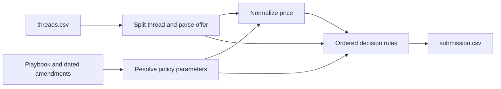

# Procurement Desk

## 1. Overview

For each CSV row, the agent splits the negotiation thread, resolves the supplier and category policy on the thread date, extracts the latest supplier offer, and converts it to INR excluding GST per category unit. It checks missing price information, blacklist status, prompt injection, banned terms, price, then approval authority, in that order. The first applicable rule determines the label. Only a counteroffer includes an integer price.

## 2. Mathematics

| Rule | Calculation and meaning |
|---|---|
| Currency and tax | Multiply by INR per currency unit (INR 1, USD 84.5, EUR 91, GBP 106 by default). A supplier-specific rate takes precedence. Divide GST-inclusive prices by 1 + GST rate. |
| Time and units | Multiply monthly prices by 12 for annual comparison and divide annual prices by 12 for monthly comparison. Divide a total by requested quantity, a batch by batch size, and a dozen by 12. For the supplied category policies, divide pack prices by 4 fixtures and multiply per-ream prices by 10 reams per box. |
| Commercial offers | For a discount of D percent use base × (1 − D/100). The base can be the list price or previous supplier quote. Apply volume discounts only at qualifying quantities. For K paid and M free, multiply by K/(K+M). Choose the tier for the requested quantity and the upper of two parsed range endpoints. |
| Concession schedule | For R > 1 rounds, clamp r to [1,R], then compute L(r) = target + (walkaway − target) × ((r−1)/(R−1))^β. The exponent controls how quickly the buyer concedes. For R ≤ 1 the implementation uses target through round one and walkaway thereafter. Probation always uses target. |
| Decision and rounding | Above L(r), counter before the final round and reject when r ≥ R. The counter is L(r) rounded to an integer with Decimal ROUND_HALF_UP. Price calculations and comparisons use floating point before counter rounding. |
| Approval | Once price is acceptable, escalate if normalized price × quantity strictly exceeds a configured approval limit. Otherwise accept. |

## 3. Architecture



## 4. Implementation

`run.py` reads rows with pandas, constructs a `ThreadRecord` for each, calls `decide`, and writes thread IDs and labels. In `src/`, `message_parser.py` implements `split_thread` and `extract_offer`. `policy_engine.py` implements `load_policy`, `get_params`, `normalize_offer`, and the concession calculations. `security_checker.py` checks injection patterns and blacklist status. `decision_engine.py` applies the priority order in `apply_rules`. `schemas.py` defines records and validates label combinations. The scripts and notebook support exploration and historical audits.

## 5. AI models and APIs

Inference uses local Python rules, regular expressions, and arithmetic. The batch run uses zero model calls and costs zero in API fees. No model name, prompt template, API key, or free-tier allowance is required.

## 6. Tricky cases

Injection patterns scan the entire thread, including earlier messages. Banned contractual terms are checked in the latest supplier message, with exceptions for recognized negations. The policy engine applies effective amendments chronologically and resolves category-specific supplier caps and currency overrides. Supplier lookup uses the normalized identifier from the CSV. A trading name in a signature does not change that identifier. An unrecognized supplier identifier can fall back to default terms.

The parser distinguishes earlier supplier quotes from buyer counters for a previous-quote discount. It recognizes explicit corrections, ranges, and quantity tiers before generic price extraction. Multiple distinct candidate prices can leave an offer unresolved and trigger a missing-information escalation.

## 7. Evaluation and changes between submissions

The historical sample audit records 27/40 exact labels for its baseline and 40/40 for the improved rules. Errors included supplier status obscured by Markdown, contract caps leaking across categories, missed injection phrases, and false positives on negated contract terms. The fixes and example-level comparisons are in [the audit report](outputs/accuracy_audit/comparison_report.md).

The final category conversion fix resolved nine differences between the former CLI output and the archived final CSV. Seven involved per-ream quotes and two involved fixture packs. On the supplied data, all 95 tests pass, including the 40-example exact-match integration check. The CLI regenerates all 2,000 rows of `submissionFinal.csv` byte for byte. Agreement with that artifact measures reproducibility. Only the worked examples have local ground truth.

## 8. Real-world application

A procurement team could use the labels to triage vendor emails and draft counteroffers. Before deployment, validate supplier identity against a vendor master, version and approve policy changes, retain decision traces, and require a buyer to authorize outgoing offers and commitments.

## 9. Drawbacks and limitations

Unfamiliar phrasing, aliases, mixed currencies, and ambiguous prices can produce an incorrect decision. Pattern matching can miss a new injection or misinterpret a negation. Missing supplier profiles can silently lose a contract restriction. Floating-point comparisons near policy boundaries deserve review. The 40 labeled examples cover a small fraction of possible negotiations.

## 10. Original work and disclosures

Project-specific code in this repository implements the parser, policy resolution, normalization, decision rules, and evaluation utilities. Competition-provided threads, worked answers, and policy documents are inputs. The runtime uses Python’s standard library and pandas. The environment also declares NumPy, pytest, and Jupyter. OpenAI Codex assisted with the category conversion fix, documentation, environment setup, and reproduction checks. Earlier AI coding-tool or template use requires confirmation from the original contributors.

## 11. Reproduce the final CSV

Use Python 3.12 and run the following from the repository root on Linux or macOS. Place the original competition dataset under `data/` with `threads.csv`, `sample_threads.csv`, `sample_answers.csv`, and the complete `playbook/` directory. The competition inputs are excluded from Git. The reference submission is `submissionFinal.csv`.

```bash
python3 -m venv .venv
. .venv/bin/activate
python -m pip install -r requirements.txt
python -m pytest -q
python run.py
cmp submission.csv submissionFinal.csv
```

A successful comparison exits with status zero and prints nothing.
